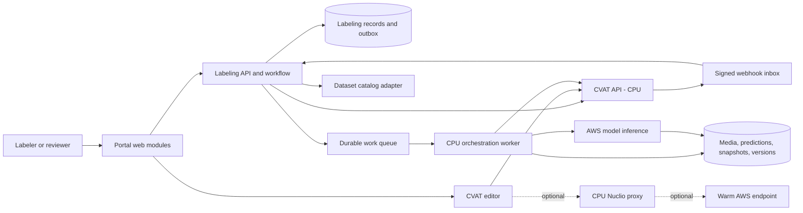
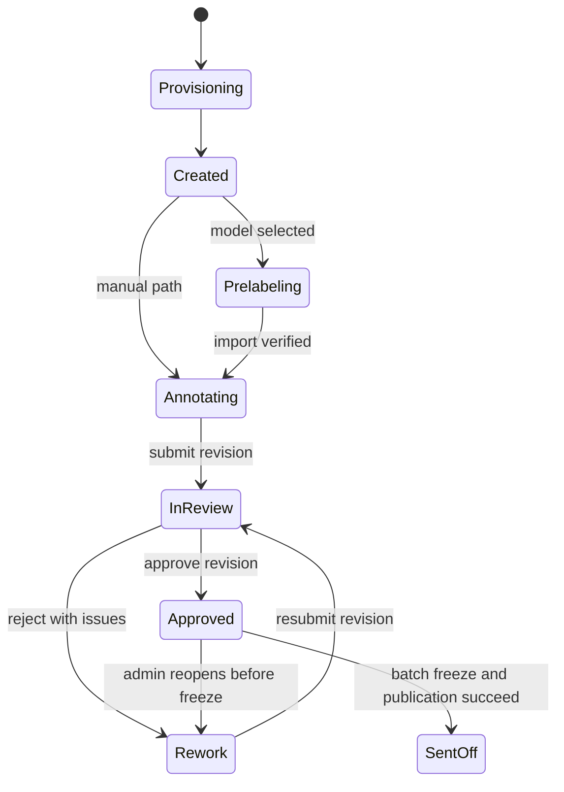

# CVAT Integration — CPU-hosted labeling, AWS model pre-labeling & labeling portal

Original: October 24, 2026 · @Kevin Stephens  
Reviewed and revised: October 28, 2026  
Status: implementation plan; the phases below describe work to build, not completed capabilities.

## Outcome and scope

Build a standalone, testable labeling integration in this repository, then finish with a versioned package ready to incorporate into the marketplace codebase. CVAT remains the annotation editor and runs on CPU infrastructure. Models run on AWS; the portal owns assignments, review policy, revisions, and dataset publication.

**The required path is Phase 0 through Phase 7.** Every phase ends with a runnable checkpoint, recorded acceptance evidence, and a safe stopping point. Phase 7 is the terminal delivery milestone: marketplace incorporation has been rehearsed in an isolated checkout, and the source, migrations, deployment assets, and runbooks are ready for a marketplace PR. Merging that PR, production deployment, and model training are subsequent work.

The core release includes manual labeling, a job inbox and board, review/rework, immutable dataset send-off, one AWS batch pre-labeling adapter, the creation wizard, and marketplace styling. Interactive AI tools, automatic tracking, advanced assignment rules, multiple-reviewer policies, and training automation are optional extensions; they do not block Phase 7.

The original [companion POC plan](https://claude.ai/artifact/UQYGxcGdpWmnX8z3xrWzsW) was not accessible during this review. This document therefore defines its own build dependencies and acceptance gates. Reconcile any additional POC requirements in Phase 0.

## Review findings and design decisions

| Original assumption | Revised decision |
| --- | --- |
| A batch maps to one CVAT task | A batch contains one or more tasks; use one task per video clip initially, each split into jobs. |
| A per-frame auto-annotation function handles asynchronous model batching | Keep model invocation and result collection separate from annotation import. The SDK function interface remains useful for a small synchronous proof or importing cached results. |
| Opening from the portal implies an authenticated CVAT session | Prove per-user authentication and organization authorization early. Marketplace login does not automatically create a CVAT session. |
| Completed/accepted jobs are locked | Approval is workflow state. Enforce write restrictions separately, including direct CVAT API access and in-flight writes. |
| Webhooks supply all workflow truth | The portal owns policy and approvals; CVAT owns live annotations. Webhooks trigger reconciliation and may be duplicated, reordered, or missed. |
| Unchanged machine shapes prove human review | Capture explicit review attestation tied to an annotation revision. Shape-level review requires additional instrumentation. |
| Every new model must lower correction rate to finish the build | Deliver measured correction metrics and lineage; model quality improvement is a later experiment, not an engineering release gate. |
| EKS and interactive GPU tools are needed for production readiness | Start with a supported CPU deployment and measured capacity; add EKS or interactive tools when justified. |
| Marketplace integration can be deferred until the last step | Establish marketplace contracts in Phase 0 and exercise them throughout the build. |

Ground Truth and Roboflow remain workflow references: assigned work, instructions, model assistance, review loops, and versioned output. AWS currently states that Ground Truth is closed to new customers; the original specific closure date is omitted because the reviewed documentation does not establish it. No component depends on Ground Truth. [AWS Ground Truth documentation](https://docs.aws.amazon.com/sagemaker/latest/dg/sms.html)

## Verified repository context

This review inspected CVAT commit `a415be662cdc8e7a271418ea1f9c20bfd9675625`. Phase 0 must select and record the supported release/commit and container digests for implementation; the inspected checkout is evidence, not an automatic release selection.

| Area | Observed implementation | Integration consequence |
| --- | --- | --- |
| CVAT UI | Ant Design `5.17.1` in `cvat-ui/package.json`, SCSS in `cvat-ui/src/base.scss` | Keep the CVAT theme patch small and independent of portal components. |
| CVAT workflow | `StageChoice` and `StateChoice` in `cvat/apps/engine/models.py` | Test the exact stage/state pairs against the pinned version. |
| Auto-annotation | `cvat-sdk/cvat_sdk/auto_annotation/driver.py` invokes `detect` per frame, sets `source="auto"`, and uploads results | Do not assume native AWS async scheduling, resumable imports, or safe replay. |
| Webhooks | `cvat/apps/webhooks/utils.py` sends `X-Signature-256` with a `sha256=` prefix | Verify the raw request body against the configured secret and a pinned-version fixture. |
| Marketplace web | `../frontend/unspaced/packages/web`: React Router 7, React 19, Tailwind 4, Radix primitives | Build portal modules for that stack, with a small standalone host for development. |
| Marketplace API | `../frontend/unspaced/packages/api`: FastAPI, SQLAlchemy, Alembic | Package labeling routes, services, models, and migrations for this backend. |
| Marketplace integration services | `app/lib/auth.session.server.ts`, `app/lib/api-client.server.ts`, `src/services/outbox_publisher_service.py`, `src/services/audit_log_service.py` | Reuse existing authentication, API access, outbox, and business audit facilities at incorporation. |
| Existing correction workflow | `src/services/ground_truth_service.py` stores correction manifests keyed by video/model | Define an explicit adapter; new dataset versions must not silently replace existing correction manifests. |

Marketplace paths above were inspected read-only. The deliverable of this review is this plan; no marketplace implementation changes are included.

## Architecture and ownership



| Component | Owns | Boundary |
| --- | --- | --- |
| Marketplace host | User identity, tenant context, source media catalog, model entitlement, navigation | Host adapters provide these capabilities to the labeling module. |
| Labeling domain | Batches, assignment policy, review decisions, operation state, send-off eligibility | No imports from CVAT UI internals; use a versioned API adapter. |
| CVAT | Annotation editing, live geometry/tracks, native jobs and frame issues | Access through API/SDK; never write directly to CVAT's database. |
| Worker | Media preparation, inference orchestration, annotation import, snapshots and exports | Uses durable operations and scoped service credentials; no model weights or GPU dependencies locally. |
| Dataset catalog | Published version registration and downstream consumption | Accepts a versioned manifest; publication events do not implicitly start training. |

During standalone development, labeling records use a separate application database and fixture host adapters. On incorporation, additive labeling tables join the marketplace database through Alembic; CVAT retains its own database. Do not create a second production identity store or parallel marketplace catalog.

Use a durable queue with retries and a dead-letter path (SQS is the AWS default), plus transactional outbox records for database-to-queue publication. Reuse existing marketplace infrastructure at incorporation. Keep CPU workers independently deployable even when API and portal source move into the marketplace.

### Proposed source layout and transfer boundary

Create these directories during implementation; they do not exist merely because they are listed here.

```text
integration/
  contracts/           OpenAPI, event and dataset schemas, compatibility fixtures
  api/                 FastAPI routes, labeling domain, persistence, adapters
  workers/             pre-label, reconciliation, snapshot and send-off workers
  web/                 React Router feature modules and standalone development host
  cvat/                versioned adapter, auth/write-guard patches, theme patch
  deploy/              Compose overrides, AWS worker assets, environment examples
  tests/               contract, integration, end-to-end and failure fixtures
  docs/                decisions, runbooks, phase evidence and incorporation guide
```

In the final transfer, web feature modules map to marketplace `packages/web/app`, API modules to `packages/api/src`, and migrations to `packages/api/src/db/migrations`. The standalone host and fixture adapters stay development-only. CVAT images and small patches remain independently versioned artifacts; do not copy the full CVAT frontend into the marketplace React application.

## Contracts to settle before feature construction

### Tenant, identity and media contracts

- Use marketplace tenant and user identifiers as external keys. Resolve tenant membership server-side on every command; never trust a client-supplied organization identifier alone. Map a tenant to a CVAT organization, and scope every CVAT resource lookup to that mapping.
- Define `IdentityContext`, `MediaCatalog`, `ModelCatalog`, `DatasetPublisher`, and `NotificationSink` host adapters. Provide fixtures and contract tests now, production bindings at incorporation.
- A media reference includes source asset ID, S3 bucket/key/version or immutable content reference, SHA-256, clip bounds, dimensions, and frame/time mapping. Signed URLs are transport credentials, never stable identifiers.
- For video, record source timestamps, clip offsets, decoding/sampling policy, and the mapping between source frames, clip frames, and CVAT frames. Handle variable frame rate explicitly. Join SRT/telemetry by timestamp, preserving missing or unaligned telemetry as a reasoned flag.
- A batch may contain many clips/tasks. A project binds to one immutable label-schema version; a schema change creates a new compatible project/task set, not mutations to a schema already used by active batches.
- Preserve class mapping, attributes, geometry type, model version/digest, preprocessing transforms, prompt version if applicable, and inference settings. An endpoint name alone does not identify reproducible model output.

### Proposed API and event contract

These are integration routes to implement, not existing CVAT endpoints. Use the marketplace `/api/v1` prefix and auth/error conventions when binding them.

| Contract | Behavior |
| --- | --- |
| `POST /labeling/batches` | Validate tenant, media, schema and policy; return `202` with batch and operation IDs. |
| `GET /labeling/batches/{id}` and `GET /labeling/jobs` | Tenant-scoped detail and paginated/filterable inbox or board projections, including sync age and operation errors. |
| `POST /labeling/jobs/{id}/editor-launch` | Check assignment and tenant access, then return an allowlisted launch destination using the selected per-user auth flow. |
| `POST /labeling/jobs/{id}/transitions` | Explicit submit, approve, reject or reopen command; require expected revision and record actor/reason. |
| `POST /labeling/batches/{id}/prelabel-runs` | Start an authorized model run on an eligible task set; return an operation ID. |
| `POST /labeling/batches/{id}/send-offs` | Validate and begin an idempotent freeze/export/publication operation. |
| `GET /labeling/operations/{id}` | Report progress, retryable failure, terminal failure, or completion and result references. |
| `POST /labeling/webhooks/cvat` | Authenticate CVAT separately, persist the delivery, and acknowledge after durable receipt. |

Mutating commands take an idempotency key scoped to tenant/action and bind it to a request hash; a repeated key with different input is a conflict. Review commands also use optimistic concurrency. Return structured error codes and correlation IDs, with `409` for stale revisions/illegal transitions and an explicit authorization response for inaccessible resources.

Publication emits `labeling.dataset_version.published.v1` through an outbox after durable publication. Include event ID, schema version, tenant ID, dataset version ID, manifest URI/version/hash, batch ID, timestamp, and correlation ID. Consumers deduplicate by event ID/version ID. Retry publication acknowledgement without creating another dataset version.

### Minimum data model

All tenant-owned records carry `tenant_id`, timestamps, and revision/concurrency fields where mutable. Foreign keys and unique constraints must prevent cross-tenant references.

| Record | Essential fields and constraints |
| --- | --- |
| `cvat_identity_mapping` | Tenant/user IDs, CVAT organization/user IDs, role and provisioning status |
| `label_schema_version` | Immutable schema content, semantic version, content hash |
| `labeling_project` | Tenant, schema version, CVAT instance/project IDs, default team |
| `labeling_batch` | Project, media manifest, review policy, instructions version, priority, due date, lifecycle |
| `labeling_task` | Batch, source clip, CVAT instance/task ID, frame mapping, provisioning operation |
| `labeling_job` | Task, CVAT job ID, frame range, assignment, portal state, CVAT projection, annotation revision |
| `prelabel_run` | Task set, model artifact identity, settings, input/output manifests, status and import ledger |
| `review_event` | Job, actor, decision, reason, reviewed snapshot/revision, issue evidence |
| `annotation_snapshot` | Job/task, format version, immutable object reference/hash, revision and reason |
| `send_off` / `dataset_version` | Batch, idempotency key, revision set, manifest/hash, publication status, predecessor version |
| `operation` / `webhook_inbox` / `outbox` | Durable work, attempts, deduplication, leases, errors and reconciliation progress |

CVAT IDs are scoped by instance; they are not marketplace primary keys. Live counts come from domain records/projections maintained transactionally, not by replaying audit logs for every page load.

## CPU deployment and authentication

### Deployment baseline

Start with pinned CVAT Docker Compose on a CPU EC2 host or equivalent development host. Include the required API, workers, UI, PostgreSQL, Redis/Kvrocks, policy engine and proxy from the selected release. Enable optional analytics only when needed. Run the integration API/worker separately with CPU-only images; AWS model compute is outside CVAT.

Original media can live in S3, but CVAT still needs durable data/cache volumes, decoding capacity, temporary import/export space, and database backups. Measure disk high-water marks and video decode throughput. Define separate lifecycle rules for temporary model payloads, prediction evidence, snapshots and published datasets. Validate cloud-storage credential behavior for the pinned CVAT deployment instead of assuming a worker IAM role automatically applies to CVAT.

Use TLS, secret injection, scoped IAM/S3/KMS permissions, tenant-specific storage prefixes, and endpoint/model allowlists. Keep database, queue and internal CVAT management ports private. Back up and restore CVAT state, integration records, and the object references connecting them. Do not log auth tokens, signed URLs, or raw sensitive media.

EKS/Helm is a later deployment option if load or existing operations justify it; validate chart persistence, external database support and upgrades before adopting it. Fargate remains suitable for the integration CPU workers without requiring a port of the whole CVAT stack.

### Per-user editor access is an early gate

The marketplace currently has its own server-side session/token handling. A marketplace cookie or bearer token is not automatically valid in CVAT. CVAT's documented integrated OIDC/SAML SSO configuration is an Enterprise feature; Community social-account configuration is a separate route to investigate. [CVAT SSO documentation](https://docs.cvat.ai/docs/account_management/sso/)

Phase 0 must choose and prove one approach: a compatible Community identity-provider configuration, a narrowly scoped maintained integration, or an explicitly selected Enterprise deployment. Separate CVAT login is acceptable for the early local baseline; seamless per-user launch must be demonstrated by Phase 2 for the intended final experience. If that requires a commercial edition, record the dependency and decision rather than silently assuming it.

Use top-level editor navigation initially. Avoid iframe/cross-site cookie complexity. Never launch with a shared admin session, put persistent credentials in a URL, or expose service tokens to the browser. If a custom exchange is needed, use a short-lived, single-use, audience-bound code tied to user/tenant/destination and a server-side session exchange. Test CSRF, return-URL restrictions, logout/revocation, reassignment, and tenant switching.

Native CVAT permissions and any integration guard must reject unauthorized direct job/task/media/export requests. Hiding navigation or filtering portal lists is not authorization. Labelers receive the minimum assignment scope; reviewers and administrators get only their intended tenant scope.

## Pre-labeling with AWS models

### Required asynchronous path

1. Validate catalog entitlement and pin the model artifact/configuration and schema mapping.
2. Provision the CVAT tasks, await media-ingestion completion, and record actual frame metadata. Keep annotator access disabled until pre-label import completes or an admin explicitly chooses manual labeling.
3. Prepare bounded frame batches with deterministic frame IDs, hashes, image dimensions and inverse preprocessing transforms. Store model inputs in S3.
4. Submit SageMaker asynchronous requests and persist their identifiers/output locations. Collect completion or failure through durable polling or notifications; retries are bounded and cancellation rejects late results.
5. Validate every prediction: allowed label/shape type, finite coordinates, image bounds, confidence policy, and correct frame mapping. Store raw results and normalized predictions independently of CVAT.
6. Import once into a non-editable task using a run/task import ledger. Reconcile an ambiguous timeout before retrying; never blindly append the same shapes or use `clear_existing` over human work.
7. Verify imported counts, provenance and frame alignment, then release the task's jobs for annotation. Partial failures remain visible and retryable; they never look like successful empty predictions.

AWS async inference reads input from S3 and writes output to S3. Scaling to zero requires configured scaling policy and a tested wake-up path; it is not a guarantee supplied by the CVAT SDK. [AWS asynchronous inference](https://docs.aws.amazon.com/sagemaker/latest/dg/async-inference.html)

The CVAT auto-annotation interface is synchronous and frame-oriented. Use it for a small real-time adapter or to map already-collected predictions; use a separate orchestration layer for AWS async work. Keep mapping validation reusable between SDK and direct annotation imports. [CVAT auto-annotation API](https://docs.cvat.ai/docs/api_sdk/sdk/auto-annotation/)

For import recovery, identify generated annotations with a stable prediction/run identifier in declared attributes or an external mapping plus a verified snapshot. Rebuild an unedited staging task if safe reconciliation is impossible. A new pre-label run after human editing requires a separate task/revision or an explicit reviewed merge operation; automatic replacement is out of scope.

### Provenance and measurement

Use CVAT's native `source="auto"` for generated shapes where supported, and declare any `origin`, `confidence`, or prediction-ID attributes in the schema before import. Preserve authoritative provenance outside editable shape attributes: model version, run ID, raw result, baseline geometry, and imported CVAT IDs.

Compute correction rate from a versioned matching method against the pre-label baseline: `(edited + deleted baseline predictions) / imported baseline predictions`. Report additions separately, use `N/A` for a zero denominator, and mark ambiguous split/merge/track matches rather than manufacturing precision. Confidence is model-specific and not a calibrated quality score by default.

A job review attestation covers a specific revision and frame range, including negative frames. It does not prove that every shape was individually inspected. Per-shape keep/edit/delete review requires explicit editor instrumentation and belongs to a later extension.

### Model hosting choices

| Mode | Use | Constraint |
| --- | --- | --- |
| SageMaker asynchronous inference | Required initial bulk pre-label integration | S3 I/O, queued completion, cold-start/retry handling and configured autoscaling |
| SageMaker Batch Transform | Optional larger offline runs | A finite job, not an endpoint; needs its own submission/result adapter |
| Real-time endpoint | Optional interactive segmentation/detection | Benchmark latency on representative media; provision and budget warm capacity |
| Serverless inference | Optional compatible small CPU model | Validate feature, networking, payload and runtime limits before selecting |

Batch Transform runs without a persistent endpoint. Serverless offers on-demand scaling but has exclusions that must be checked against deployment requirements. [AWS Batch Transform](https://docs.aws.amazon.com/sagemaker/latest/dg/batch-transform.html), [AWS Serverless Inference](https://docs.aws.amazon.com/sagemaker/latest/dg/serverless-endpoints.html)

Optional CPU Nuclio proxies can connect CVAT in-editor detectors/interactors to AWS. They need scoped authorization, coordinate transforms, bounded requests, timeouts, and graceful unavailable states. Treat a one-second response as a benchmark target, not a promise. Endpoint shutdown/recreation or supported scaling behavior must be tested before promising off-hours savings.

## Portal and review workflow

### User-facing scope

| View | Users | Required behavior |
| --- | --- | --- |
| My jobs | Labelers | Assigned jobs, due dates, instructions, operation state, editor launch and submit |
| Review queue | Reviewers | Submitted revisions, issues, approve/reject with reasons and reopen history |
| Board | Tenant admins/leads | Filtered job state, assignment, priority, failures, sync age and guarded bulk commands |
| Batch detail | Admins | Task/clip progress, pre-label runs, review evidence, snapshots, export/send-off status |
| Creation wizard | Authorized creators | Media, schema, optional model preview, split, assignment, instructions, priority and due date |

Start with manual assignment and one independent reviewer for every job. Keep creator/admin overrides explicit and audited. Advanced distribution and sampled/multiple approvals are later policy modes; a sampled policy must define coverage and whether it may publish without reviewing every job.

The wizard creates one task per video clip initially, configures segmentation, waits for asynchronous ingestion, discovers job IDs, then assigns or pre-labels. Store an operation per provisioning step so partial failures can be resumed without duplicate tasks. Instructions belong in the portal and, where supported, a CVAT annotation guide; retain a version in each batch.

### Lifecycle and authority



Provisioning, pre-labeling, snapshots and send-off also have separate operation states: `queued`, `running`, `retrying`, `failed`, `cancelled`, `succeeded`. A worker failure must not overwrite the job's last valid review state. Rework returns to editable annotation; portal status stays Rework until resubmission.

| Portal status | Proposed CVAT stage/state | Authority and guard |
| --- | --- | --- |
| Created | `annotation` / `new` | Media ready; no editor access during preparation |
| Pre-labeling | `annotation` / `new` | Portal operation; worker-only annotation writes |
| Annotating | `annotation` / `in progress` | Explicit start or first confirmed save; opening a link alone is insufficient evidence |
| In review | `validation` / `new`, then `in progress` | Submit snapshots the revision; annotator edits blocked |
| Rework | `annotation` / `rejected`, then `in progress` | Reviewer rejection records issues; labeler may edit |
| Approved | `acceptance` / `completed` | Portal approval references the exact revision and resolved issues |
| Sent off | Remains `acceptance` / `completed` | Batch publication state and write guard, not a native CVAT lock |

Validate stage/state transitions against the pinned API and permissions. Out-of-band CVAT changes reconcile as observations; they must not fabricate a portal approval. Any annotation change after approval invalidates that approval. Reviewer corrections require a new snapshot/revision and fresh approval evidence.

### Reliable updates and snapshots

Verify signed webhook bodies, persist an inbox record, then process asynchronously. Deduplicate by a verified delivery identifier when available or an explicit payload/resource key. Refetch authoritative resource state to handle old deliveries; a webhook alone cannot authorize a transition.

Reconcile active work on a configurable short interval (initial target: five minutes), after failed operations, and immediately before approval/send-off. Retain a nightly full sweep for drift and deleted resources. Assignment/review notifications come from domain transitions; due-soon notifications require a scheduler. Notifications are not a prerequisite for saving work.

At submit, reject, approve and reopen, capture an immutable annotation snapshot plus issue state and actor/reason. Use a write barrier or before/after revision checks so the snapshot is coherent. Snapshot failure leaves the transition pending/failed, never falsely completed. Restore creates a new audited revision and invalidates prior approvals.

### Send-off protocol

Send-off is an asynchronous batch operation with a stable dataset version ID. The core policy requires every ordinary annotation job approved at its current revision, no unresolved blocking issues, complete required review attestations, validated class/schema counts, and telemetry present or explicitly flagged with a reason. Account for auxiliary ground-truth jobs separately from ordinary jobs.

1. Acquire the batch lease, persist the send-off ID, and enforce a write barrier over the batch's CVAT tasks. Block annotation edits, import/deletion/media/schema changes and reopen operations that would invalidate the snapshot. Drain or reject in-flight writes before continuing.
2. Reconcile all jobs/issues and compare current revisions with approved snapshots. Abort or return for review on any mismatch. A stale portal projection cannot satisfy this check.
3. Export a coherent task-level dataset, preserving native annotation information and generating the agreed consumer format. Resolve overlapping job frames once; do not concatenate job exports and duplicate annotations.
4. Write immutable objects and a manifest containing tenant, schema, media hashes/frame mapping, telemetry status, CVAT version, model provenance, review evidence, format versions, artifact hashes and predecessor version.
5. Verify object hashes and completeness. Register the version through the catalog adapter, then record publication and an outbox event. If registration is remote, use idempotent retries and keep the batch in Publishing until registration is acknowledged; do not assume a cross-system transaction.
6. Mark Sent off only after durable publication. Keep source jobs non-editable under the integration guard. Later edits begin a revision batch and publish a new version.

A portal flag or CVAT `completed` state is insufficient for step 1. In Phase 0, prove a server-enforced guard across direct API and worker mutation paths; use a narrow CVAT extension if native permissions cannot express it. Include pre-existing browser sessions in the tests. If comprehensive enforcement is not available, do not claim lock/freeze acceptance has passed.

Published objects use unique/versioned keys, hashes, and IAM rules preventing application overwrite/delete; S3 versioning alone is not an immutability guarantee. Select retention and optional Object Lock requirements explicitly. CVAT editing privileges and dataset artifact retention are separate controls.

If send-off fails before publication, expose retry/recovery; do not delete evidence or create another version on replay. An explicit abort may unfreeze a batch only after confirming no version has been published. Catalog-event delivery failure retries through the outbox without reopening the published batch.

## Marketplace appearance and accessibility

Use the inspected marketplace `packages/web/app/styles/globals.css` as the starting token source. Preserve an exported, versioned token fixture in the integration so a standalone build does not require sibling checkout paths. On incorporation, generate/update that fixture from the marketplace and detect drift in CI.

Map tokens into CVAT's Ant Design `ConfigProvider` and the necessary SCSS overrides: primary, text, surfaces, borders, radii, shadows and fonts. Support both light and dark palettes; do not hard-code black as primary in dark mode. Confirm font assets are loaded in each application rather than assuming a CSS font-family declaration loads them.

Reskin the annotation workspace, sign-in/error states, and navigation back to the portal first. Preserve label colors, canvas behavior, keyboard shortcuts and tool icons unless a specific usability issue requires change. Keep styling and auth/write-guard changes as separate reviewable patches for upgrades.

Use shared text labels plus neutral/blue/amber/green/red status treatments. Do not adopt white text on `#61c200` as a default success badge; choose foreground/background tokens that meet contrast requirements. Verify keyboard focus, disabled states and text contrast in both themes. Hiding CVAT navigation is a presentation choice, never a security boundary.

## Build phases and stopping points

Every phase produces a versioned checkpoint with scope, dependency versions, setup commands, demo data, acceptance results, known limitations and the next phase's prerequisites in `integration/docs/phases/`. Earlier checkpoints are usable for their stated scope; only Phase 7 may be labeled **ready for marketplace incorporation**. Do not advance while a required gate is merely mocked or undocumented.

| Phase | Depends on | Build output | Runnable stopping point |
| --- | --- | --- | --- |
| 0 — Contracts and feasibility | None | Version decision, architecture decisions, auth/write-guard spikes, contract fixtures, capacity envelope | Reproducible capability harness and agreed integration boundaries |
| 1 — CPU baseline and data bridge | 0 | Pinned CVAT, storage, tenant/task provisioning, webhook inbox, reconciliation | Manual CVAT labeling of fixture clips with durable portal-side state |
| 2 — Standalone portal and access | 1 | Marketplace-compatible development host, inbox, board, assignment, per-user editor launch | Authorized users can manage and label their assigned work end to end |
| 3 — Review and immutable delivery | 2 | Review/rework, revision snapshots, guarded send-off, dataset publisher fixture | A manual-only batch can produce a verified immutable dataset version |
| 4 — AWS batch pre-labeling | 3 | One model adapter, async orchestration, safe import, provenance/correction reporting | The same workflow works with real AWS-generated pre-labels or manual mode |
| 5 — Creation workflow and theme | 4 | Complete core wizard, preview, operational metrics, editor theme | Complete standalone product workflow with marketplace appearance |
| 6 — Release qualification | 5 | Failure/security/capacity tests, restore/upgrade evidence, deployment/runbooks | Operationally qualified release candidate within its documented load envelope |
| 7 — Marketplace incorporation package | 6 | Versioned source/artifacts, migration plan, host bindings and integration rehearsal | Terminal handoff: tested package ready to incorporate into the marketplace |

### Phase 0 — Contracts and feasibility

- Pin server/UI/SDK versions and image digests; record edition/license-dependent capabilities individually. Do not classify all QA or all custom-model features from a single marketing label.
- Exercise task creation from a clip, ingestion polling, job assignment, review transitions, issue resolution, annotation export and webhook verification against real CVAT.
- Prove per-user auth and a write guard including concurrent saves. Record the chosen implementation and any small upstream patches before depending on them.
- Approve v1 API/event/dataset schemas and host-adapter fixtures, including conversion/coexistence with existing video/model correction manifests.
- Define a representative load fixture: clip duration/resolution, frames per job, concurrent users, batch size, cost ceiling, API/editor latency targets and recovery objectives. Record measured targets rather than promising arbitrary instance sizes.

**Exit:** capability evidence exists for the chosen CVAT edition/version; authentication and freeze enforcement have a viable tested design; marketplace target paths and contracts are concrete. Unresolved auth, tenancy, frame mapping or write-barrier feasibility blocks this gate.

### Phase 1 — CPU baseline and data bridge

- Build repeatable local/CPU-host deployment, environment examples and health/readiness checks.
- Provision two isolated tenants and multiple clips/tasks/jobs through a durable operation; retain stable source/frame references.
- Implement signed webhook ingestion and periodic reconciliation, including failed task creation and cleanup/recovery.
- Establish backup locations and perform an initial state restore.

**Exit:** an assigned user can label a real clip; CVAT changes appear in the projection within the configured sync objective; dropped/duplicate events converge; a second tenant cannot access the first tenant's media or jobs. No local GPU runtime is required.

### Phase 2 — Standalone portal and access

- Build the portal feature modules using fixture host adapters and the marketplace-compatible stack.
- Implement My jobs, board, batch detail, manual assignment and editor launch, with loading/empty/failure/stale states.
- Complete actual per-user session integration and server-enforced assignment/tenant checks.

**Exit:** labeler, reviewer and admin journeys work with real CVAT; direct URL/API access, tenant switching, expired sessions and reassignment are tested. Shared admin sessions and stub authentication are disallowed at this gate.

### Phase 3 — Review and immutable delivery

- Implement explicit submit/reject/resubmit/approve/reopen commands, frame issues and revision-bound snapshots.
- Default to one independent reviewer and complete job coverage. Enforce read/write restrictions during review, approval and publication.
- Implement send-off, canonical/native export, consumer-format conversion, immutable manifest and idempotent catalog registration through a fixture publisher.

**Exit:** a rejected job returns with issues; reapproval targets the new revision; simultaneous edit/send-off cannot publish unreviewed content; retry after export/registration failure yields exactly one published version. A revision batch leaves the original dataset version unchanged.

### Phase 4 — AWS batch pre-labeling

- Integrate one fixed model version on a real AWS async endpoint; use a fake endpoint for deterministic offline tests.
- Implement input preparation, bounded queueing, completion collection, import reconciliation, cancellation and explicit manual fallback.
- Validate a fixture containing resize/letterbox transforms, nonzero clip offset, sampled/variable-rate frames, empty predictions and unknown model labels.
- Record the baseline, reviewer attestation and correction metrics with method limitations.

**Exit:** pre-labels align with the expected CVAT frames/coordinates before editing is enabled; timeout/replay cannot duplicate shapes or erase human edits; failed and zero-detection runs are distinguishable. Real AWS evidence and per-batch resource/cost measurements accompany offline tests.

### Phase 5 — Creation workflow and theme

- Complete media/schema/model selection, preview, task/job split estimates, manual assignment, instructions, priority and due date.
- Show actual task/job counts after ingestion, and surface partial provisioning or inference failures with recovery actions.
- Add throughput, rejection, queue age, inference duration and measured correction metrics; label unavailable time-on-task metrics honestly until instrumented.
- Apply the focused CVAT/portal token mapping, fonts, branding and Back to portal navigation. Expose notification hooks; optional email/Slack delivery is not a core gate.

**Exit:** an admin can create a multi-clip batch, labelers correct pre-labels, reviewers request rework, and an admin publishes a version in one demonstrated flow. Manual-only mode works with model services disabled. Light/dark themes and keyboard navigation pass UI review.

### Phase 6 — Release qualification

- Run the agreed capacity fixture and record p95 API/editor load latency, import/export duration, queue age, CPU/memory/disk peaks and AWS usage against the Phase 0 envelope.
- Exercise worker crashes, expired credentials, unavailable CVAT/model endpoints, lost/duplicate/reordered webhooks, concurrent review, delayed inference completion, partial exports and catalog downtime.
- Verify direct API tenant isolation and write barriers, including old sessions and service-worker paths. Validate least-privilege roles and secret rotation.
- Restore the connected system from backups and verify media/snapshot references; record achieved recovery point/time. Rehearse the pinned-version upgrade and patch reapplication.
- Document alerts, retry/dead-letter recovery, capacity limits, retention/deletion, access revocation and rollback. Cost/concurrency caps must prevent unbounded model fan-out.

**Exit:** all core gates pass within the declared workload; no unresolved defect can leak tenant data, corrupt annotations, bypass approval or alter a published version. Other limitations are recorded with an owner and an explicit scope constraint.

### Phase 7 — Final marketplace incorporation package

Prepare a transfer-ready release and rehearse incorporation in an isolated marketplace checkout using test services/accounts. This is more than a demo in the standalone shell.

- Package web feature modules, API/domain/worker modules, pinned CVAT images/patches, schemas, generated clients where used, fixtures, licenses/notices and deployment assets with release checksums.
- Bind the module to real marketplace identity/tenant context, media/model catalog access, API client, audit log, outbox and dataset publication conventions. Confirm route, dependency and identifier compatibility.
- Rebase additive Alembic migrations onto the marketplace migration head. Test clean install and upgrade from a representative existing database; document rollback compatibility and any data-preservation constraints.
- Define existing-data adoption explicitly: no automatic production CVAT backfill by default. Supply a dry-run mapping/import procedure if existing tasks must be adopted.
- Produce a file-by-file incorporation manifest, configuration/secret/IAM inventory, feature-flag rollout plan, deployment ordering, and a reviewable patch or PR-ready change set. Use the marketplace's version-based release process without deploying as part of this phase.
- Run the end-to-end acceptance flow from the marketplace shell, through real CVAT and the test AWS adapter, to the agreed dataset consumer. Verify the existing correction-manifest workflow still works.

**Exit / definition of ready:** all of the following are checked with linked evidence:

- [ ] A fresh checkout can build and start the standalone release using documented commands.
- [ ] Marketplace web typecheck/build and relevant backend, migration, contract and end-to-end checks pass in the integration rehearsal.
- [ ] A fixture source clip retains correct frame/time/telemetry identity through pre-label, review, export and marketplace consumption.
- [ ] Existing marketplace authentication, tenant switching, navigation and correction workflows pass targeted regression checks.
- [ ] Feature flag off preserves the marketplace's current behavior; flag on enables the complete core flow for an allowed tenant.
- [ ] A manual-only batch and an AWS-pre-labeled batch each publish exactly one immutable version after review/rework.
- [ ] Deployment/migration order and rollback preserve existing marketplace and CVAT data.
- [ ] Production-specific secrets and resources are named/configurable, with owners; no unresolved architectural or API-schema decision is hidden as a deployment task.
- [ ] The handoff contains source mapping, dependency pins, release artifacts, test evidence, runbooks, limits and owners; the standalone harness is marked development-only.

**Terminal state:** ready to incorporate into the marketplace codebase. Production rollout is a separate execution decision; optional enhancements below are a separate backlog.

## Optional extensions after the core release

| Extension | Prerequisite | Independent acceptance |
| --- | --- | --- |
| In-editor detection/segmentation | Phase 4 contracts and Phase 6 access/cost controls | Nuclio proxy works with authorized model access, measured latency and safe unavailable state |
| Automatic video tracking | Stable frame mapping and provenance | Track import/export preserves IDs, keyframes, outside flags and boundary behavior |
| Advanced review policies | Revision-bound review evidence | Sampling/multiple approvals have explicit publication rules and tested coverage |
| Training feedback loop | Published dataset contract and model catalog registration | Dataset-to-model lineage is preserved and the new version can pre-label a subsequent batch |
| Per-shape review and richer analytics | Editor instrumentation and provenance IDs | Review events and timing are measurable, auditable and clearly defined |
| EKS or higher-scale deployment | Measured need beyond the qualified baseline | Persistence, scaling, restore, upgrade and costs validated for the new deployment |

For training experiments, compare model versions on comparable held-out data and labeling effort. A falling correction rate is useful evidence, but is not guaranteed by the integration and is not the terminal build criterion.

## Decision and risk register

| Decision/risk | Required resolution | Gate |
| --- | --- | --- |
| Companion POC requirements unavailable | Reconcile with this self-contained scope; record changes | Phase 0 |
| CVAT edition/auth compatibility | Prove selected per-user session approach and record edition dependencies | Design in 0; complete in 2 |
| Freeze enforcement and concurrent writes | Test server-side guard on every relevant mutation path | Proof in 0; complete in 3 |
| Marketplace dataset/legacy correction compatibility | Agree manifest schema and consumer adapter with fixtures | Contract in 0; rehearsal in 7 |
| Variable-rate video and telemetry drift | Persist and test source-to-CVAT frame/time mapping | Phase 1; expanded in 4 |
| Pre-label retries overwrite/duplicate work | Import ledger, exclusive preparation, provenance and reconciliation | Phase 4 |
| Missed events or bypassed workflow | Reconcile authoritative state; invalidate stale approvals | Phases 1–3 |
| Feature availability changes between CVAT releases | Capability matrix backed by the pinned source and integration tests | Phases 0 and 6 |
| CPU decoding/export bottlenecks and storage growth | Benchmark bounded workloads and retention; scale measured bottlenecks | Phase 6 |
| Optional GPU cost or weak model output | Concurrency/cost limits, model preview and manual fallback | Phase 4; interactive extension |
| Tenant data retention and deletion | Retention policy covers source media, predictions, backups and published versions | Phase 6 |
| Marketplace dependency/schema drift during standalone build | Recheck target revision and run a clean incorporation rehearsal | Phase 7 |

## References

Local implementation is authoritative for the checked-out revision; current product documentation informs capability checks, not promises about a future pinned release.

- [CVAT workflow enums](cvat/apps/engine/models.py), [auto-annotation driver](cvat-sdk/cvat_sdk/auto_annotation/driver.py), [webhook implementation](cvat/apps/webhooks/utils.py), [Compose deployment](docker-compose.yml)
- [Local SSO documentation](site/content/en/docs/account_management/sso.md), [social authentication](site/content/en/docs/account_management/social-accounts-configuration.md), [quality control](site/content/en/docs/qa-analytics/quality-control.md), [video task creation](site/content/en/docs/workspace/tasks-page.md)
- [Marketplace web stack](../frontend/unspaced/packages/web/package.json), [theme tokens](../frontend/unspaced/packages/web/app/styles/globals.css), [API stack](../frontend/unspaced/packages/api/pyproject.toml), [release conventions](../frontend/unspaced/packages/api/README.md)
- [Marketplace session handling](../frontend/unspaced/packages/web/app/lib/auth.session.server.ts), [API client](../frontend/unspaced/packages/web/app/lib/api-client.server.ts), [outbox publisher](../frontend/unspaced/packages/api/src/services/outbox_publisher_service.py), [existing correction manifests](../frontend/unspaced/packages/api/src/services/ground_truth_service.py)
- AWS and CVAT external references are linked beside the relevant claims above; reviewed October 28, 2026.
